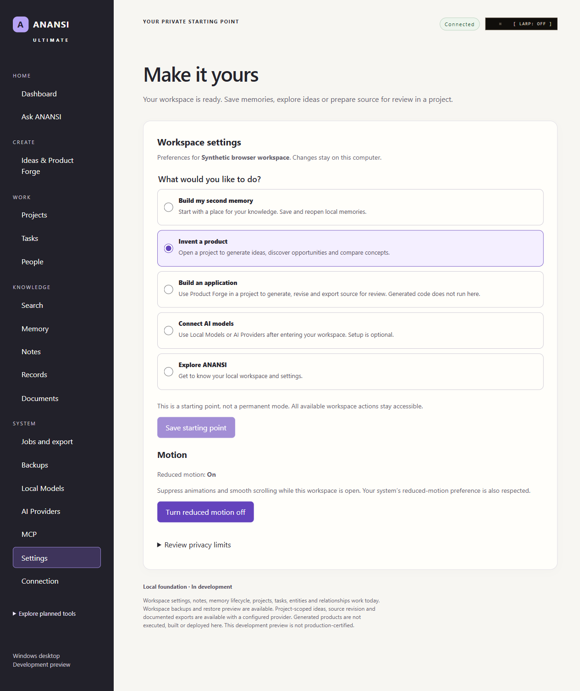
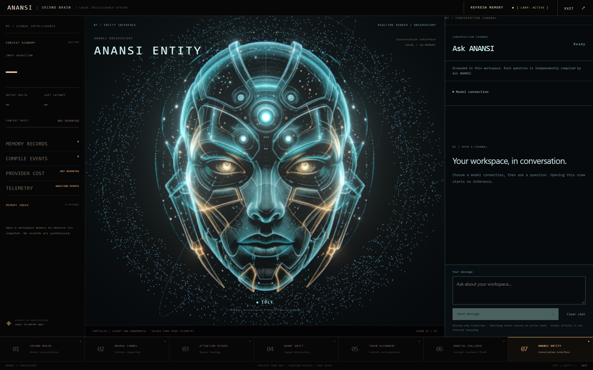
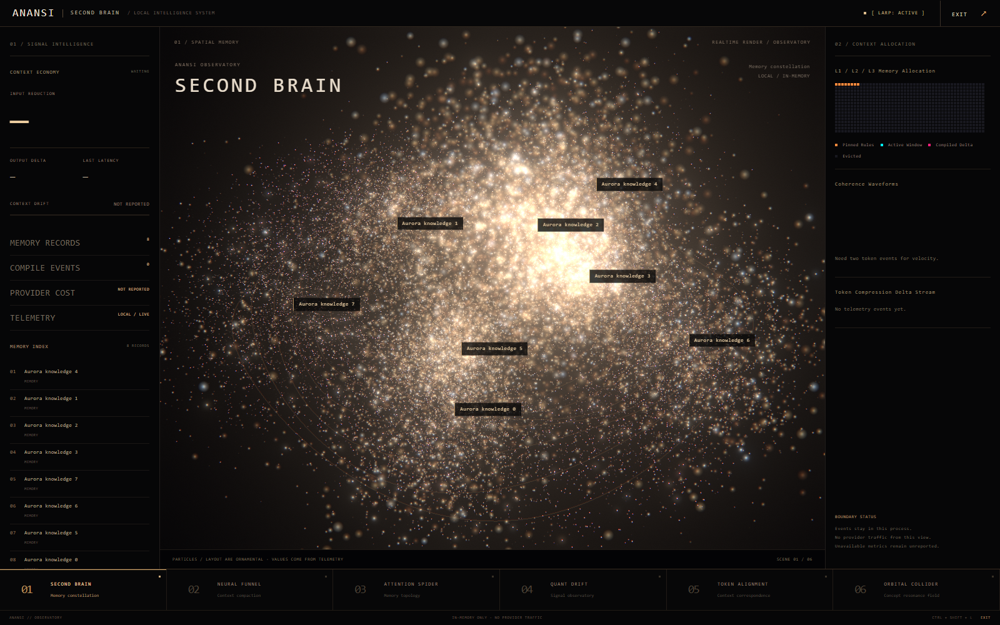
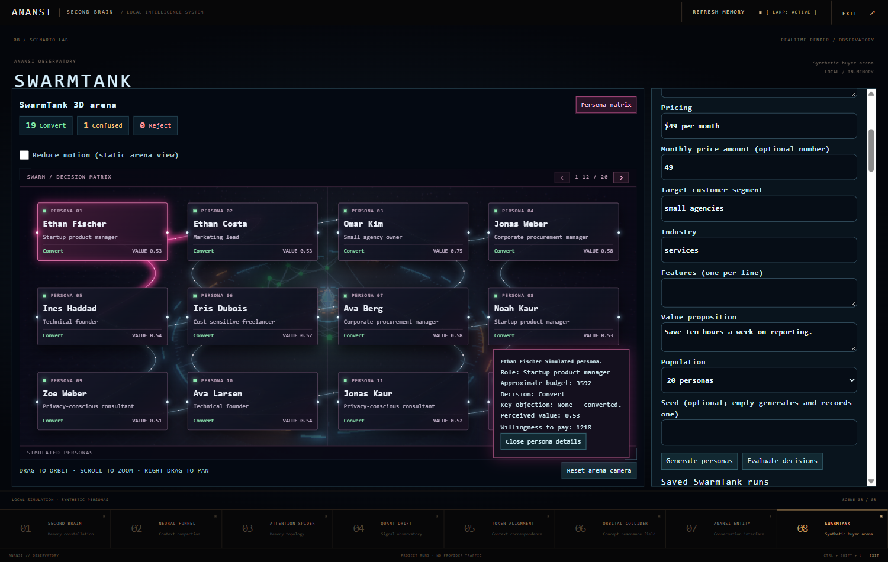
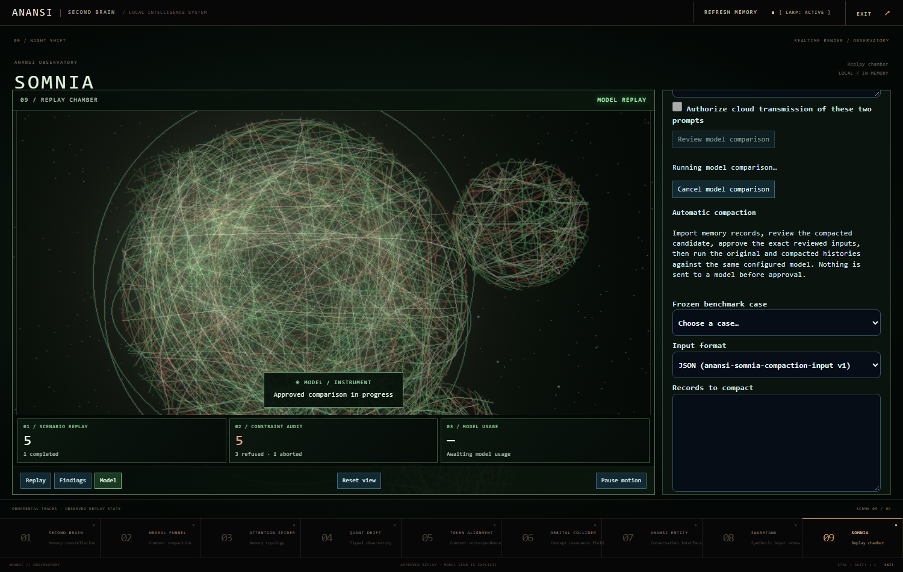
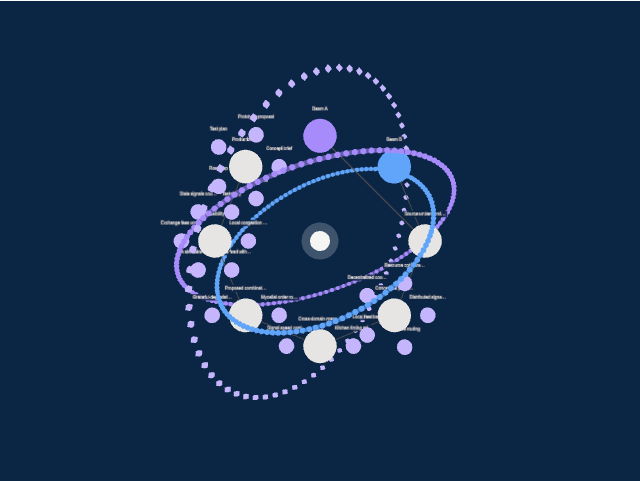

# ANANSI Ultimate

ANANSI Ultimate is a local-first workspace for researching a product idea, building a prototype plan, testing assumptions, and preserving the evidence behind each decision. It has a Windows desktop application built with Tauri 2 and a React browser interface paired to a local API. Both interfaces use the same Rust domain logic and generated contracts.

**Development status — 13 November 2026.** An integrated unsigned Windows pilot installer has been built from clean application source `6f216e3224e2c855236aac5492f69b467cf8c5d5`. Recovery acceptance passed **416/416** in one Windows library run; the first-time browser journey, strengthened native smoke, isolated installed-app workflow, and actual Windows document-picker checks also passed in their recorded scopes. This branch includes the delivered source, qualification harness repairs and reviews through `8d7e72ed`. **This is not a production release or unrestricted customer-pilot approval.** Clean-VM/upgrade testing, real credential-store acceptance and other gates remain open. Publishing source does not replace an installed preview. See [current verification](#current-verification-and-remaining-work), the [pilot decision sheet](docs/pilot/release-decision-sheet.md), and the [build status ledger](docs/BUILD_STATUS.md).

- [Who it’s for](#who-its-for)
- [Screenshots](#screenshots)
- [What you can do](#what-you-can-do)
- [Current verification and remaining work](#current-verification-and-remaining-work)
- [Windows preview](#windows-preview)
- [SOMNIA compaction](#somnia-compaction)
- [Run from source](#run-from-source)
- [Development and verification](#development-and-verification)
- [Repository map](#repository-map)
- [Project roadmap](#project-roadmap)

## Who it’s for

- **Founders and indie builders** can turn research into product concepts, compare ideas, draft specifications, and export prototypes and launch materials for review.
- **Product and research teams** can keep source documents, assumptions, decisions, and versioned artifacts together, then revisit the evidence behind a recommendation.
- **Developers and AI practitioners** can inspect what context reaches a model, compare original and compacted histories in SOMNIA, and review generated source before handing it off.

Start with a project and add a few notes or documents. Use **Ask ANANSI** to get a cited answer, **Opportunity Discovery** to explore ideas, **Product Forge** to draft a prototype, and **SwarmTank** to test assumptions against synthetic buyer scenarios. You can reopen the saved inputs and results as the project evolves.

## Screenshots

Application captures from Windows review builds using synthetic workspaces. The captures come from several preview checkpoints.

**Current Windows pilot candidate · Installed-app settings**

Captured during the installed desktop/browser parity check using synthetic workspaces. This is the ordinary desktop interface; the LARP screenshots below show optional visualization scenes.



**ANANSI Entity · LARP scene 07**
The holographic avatar and the grounded Ask ANANSI conversation panel.



**Second Brain · LARP scene 01**
A navigable constellation of sample workspace memories.



**SwarmTank · LARP scene 08**

The interactive persona matrix with a selected synthetic buyer and scenario controls.



**SOMNIA · LARP scene 09**

The replay chamber during a synthetic model comparison, with the automatic compaction panel visible.



**LEXI-COLLIDER · Project visualization**
The reviewed Three.js view of a saved synthetic experiment.



## What you can do

| Area | Workflow |
| --- | --- |
| **Home and Projects** | Resume recent work, open a project or guided lifecycle step, and see local status, queued jobs, and backup health. |
| **Memory and search** | Capture and revise records, link them to projects and other records, archive and restore them, and search through lexical and configured semantic retrieval. |
| **Ask ANANSI** | Ask questions against approved workspace material. Review the grounding evidence and citations alongside the answer. |
| **Connect AI** | Add API-key provider connections through the desktop-owned credential flow while preserving existing connections and budgets. Paired browsers receive status and directions to the desktop owner. |
| **Opportunity Discovery** | Supply problems, observations, excerpts, and selected memories. Generate hypotheses with sources and assumptions, save them as project artifacts, and compare them against a rubric. |
| **Product Forge** | Turn an opportunity into a specification or implementation plan, review proposed revisions, and export a prototype package. |
| **LEXI-COLLIDER** | Combine prompts, concepts, and selected project context. Review the result before transferring it into Forge. |
| **SwarmTank** | Explore synthetic buyers in the arena, compare assumptions and scenarios, and replay how outcomes change across a timeline. |
| **SOMNIA** | Replay isolated scenarios, inspect failures, compare two reviewed model inputs, and save comparison evidence in a private project artifact. |
| **GHOST-PROMPT** | Explore prompt drafts, revisions, and alternative formulations through an explicit opt-in workflow. |
| **Launch Studio** | Follow the product lifecycle, review its deliverables, and package an export for handoff. |
| **Documents and MCP** | Import text, Markdown, supported PDF text, and text-bearing DOCX with provenance, resumable uploads, search, and citations. Review MCP tools, resources, and prompts, with scoped approval for mutations. |
| **Backups and recovery** | Create and inspect a backup, preview a restore, and recover into a fresh workspace. |

A typical session starts with a workspace and project. Add source material, explore an opportunity, move a candidate into Forge, then test the assumptions in SwarmTank or SOMNIA. Save the inputs and results as project artifacts so you can inspect the evidence behind a decision later.

## Current verification and remaining work

These results belong to the exact source and workflows named below. Passing one workflow does not certify every product requirement. The application binary remains the one built from `6f216e3`; subsequent harness and documentation changes did not rebuild or relabel it.

| Accepted Windows check | Result and scope |
| --- | --- |
| Broad workspace library acceptance | **416/416**, all four library binaries in one default-concurrency invocation at reviewer `8453f649`; core 348, API 4, desktop 1, providers 63. |
| Queue/mirror/gate and independent recovery probes | 24/24 and 2/2 at the same review; witness also passed three additional runs. |
| First-time browser pilot journey | **1/1 in 2.4 minutes** on `8931d34b`: setup, imports, search, cited Ask with a local fake model, cancellation, restart, backup/fresh restore and reopen. |
| Installer-qualification tooling | Node 61/61 and release-tooling 54/54 on `7c3af5e`; separate tooling checks, not installation evidence. |
| Isolated Windows release build | Web, API, desktop and NSIS all exit 0 on clean source `6f216e3`; seven artifact hashes/sizes verified. |
| Strengthened native candidate smoke | **7/7** using harness `b0249927` and the unchanged built app: actual readiness, capability denial, artifact readback, cross-workspace refusal and restart persistence. Regression/docs/hygiene checks 36/36. |
| Isolated installation and installed UI | Install, payload identity, native/browser onboarding/settings/restart parity, uninstall and byte-identical catalog preservation passed after a stale test-selector repair. Same host with clean ANANSI registration, **not a clean Windows VM**. |
| Actual Windows document picker | **Eight observed cases passed:** cancel, Unicode TXT, Markdown, PDF, DOCX, oversized, empty and unsupported files. Four successful imports/four completed jobs persisted; every stored body hash verified after close. |

The earlier broad-run parking timeouts and the later witness timing assumption are superseded by the accepted synchronized harness and the clean **416/416** aggregate. The older failures remain in their historical reports. [Recovery acceptance](docs/reviews/windows-wr-rec-witness-gate-review.md) · [Browser journey](docs/reviews/windows-v1-pilot-rc-review.md) · [Build identity](docs/reviews/windows-v1-pilot-release-build.md) · [Native smoke](docs/reviews/windows-nq01-native-harness-review.md) · [Installed workflow](docs/reviews/windows-v1-installer-workflow-qualification.md) · [Native picker](docs/reviews/windows-native-document-picker.md) · [Published evidence](docs/evidence/windows-pilot-2026-11-13/index.md)

The preceding ingestion-reliability checkpoint `3e86af6b4` passed the complete Windows library suite, 370/370, plus 23 browser tests. Those historical results remain scoped to that checkpoint; they are not substituted for the latest run. [Accepted-checkpoint handoff](docs/handoffs/windows-ingestion-test-reliability.md)

Recent work now in source:

- **DOCX ingestion:** bounded ZIP/XML extraction, heading provenance, inert text display, restart/resume, backup/restore, and section-aware Ask citations. Macros, encrypted files, unsupported structures, and oversized input are refused. OCR is separate work. [DOCX handoff](docs/handoffs/m13-docx-ingestion.md)
- **SQLite dependency repair:** bundled SQLite updated to 3.54.1, with linked-version verification and old-workspace reopen/search/write/restore evidence. [Dependency repair](docs/handoffs/pilot-sqlite-security-repair.md)
- **SOMNIA target binding:** approval-bound requests pin the selected provider/model and relevant connection configuration; configuration changes cannot silently redirect an approved comparison. [Expected-target contract](docs/handoffs/expected-target-contract-repair.md)
- **Connect AI:** additive provider setup, connection-bound verification status, and removable orphaned credential references. [Setup](docs/handoffs/connect-ai-api-key-setup.md) · [Verification repair](docs/handoffs/connect-ai-verification-repair.md)
- **ChatGPT sign-in prototype:** synthetic OAuth and token-lifecycle coverage, typed credential-store failures, and guarded callback/refresh/disconnect races. The sign-in control remains disabled and dev-gated. Real account eligibility and native credential-store acceptance are open. [Prototype](docs/handoffs/connect-ai-chatgpt-signin.md) · [Lifecycle review](docs/handoffs/connect-ai-chatgpt-signin-lifecycle-repair-4.md)
- **Background-job recovery:** FIFO scheduling, bounded retries for unavailable storage, non-retryable parking, sanitized recovery diagnostics, and explicit Retry recovery controls. Passive polling preserves retry budgets, including in-flight work. The recovery test-reliability line now has clean focused Windows aggregate acceptance. [Recovery handoff](docs/handoffs/claim-recovery-cr01b.md) · [Accepted witness repair](docs/reviews/windows-wr-rec-witness-gate-review.md)

Before a wider Windows pilot, complete clean-VM/upgrade and SmartScreen observations, actual credential-store acceptance, native fresh restore, concurrent-import observation and the remaining workflow gates. Representative document-import picker behavior is verified; save/export dialogs and every possible input are not. ChatGPT OAuth is **deferred and disabled for v1**. Generated-code execution, external audits and production qualification remain separate. No new model or provider is installed automatically.

### Pilot documentation and privacy

- [First-time-user guide](docs/pilot/user-guide.md), [tester checklist](docs/pilot/tester-checklist.md), [troubleshooting](docs/pilot/troubleshooting.md), and [sanitized bug-report template](docs/pilot/bug-report-template.md).
- [Limitations and privacy](docs/pilot/limitations-and-privacy.md): ordinary workspace storage and backups are plaintext; privacy labels do not encrypt files. Use synthetic or non-critical data during qualification.
- TXT/Markdown: at most **65,536 bytes / 8,000 text characters**. PDF/DOCX: at most **1 MiB / 32,000 extracted text characters**. OCR is not included.
- The present Ask view accepts a local loopback model endpoint. Other provider workflows require their existing authorization and cost controls. Fake-model tests establish workflow behavior, not model-answer quality.
- The installer is **unsigned**. Keep `packaging.json` with it: source commit, clean/dirty state and installer/application/config hashes identify the build; the generic `0.1.0` version does not.

### SwarmTank v2

SwarmTank starts with synthetic personas and an explicit scenario. The preview adds searchable territories, researched profiles with source and date information, and custom assumptions for markets without a profile. Its timeline supports a configurable horizon and step size, scheduled events, and what-if branches such as a price change or competitor launch.

Choose the deterministic path for repeatable scenario exploration, or explicitly configure and authorize a provider for model-backed simulation. The Windows review exercised provider dispatch with a synthetic provider, including malformed responses, budget exhaustion, and cancellation that preserves completed rounds. Synthetic persona outcomes support comparison and hypothesis generation. The calibration plan describes future work to compare them with independent observations. [SwarmTank v2 design](docs/handoffs/swarmtank-v2-design.md) · [Timeline and what-if branches](docs/handoffs/swarmtank-v2-checkpoint3.md) · [Calibration plan](docs/handoffs/swarmtank-v2-calibration-plan.md)

### SOMNIA replay and comparison

1. Open SOMNIA from a project or from LARP scene 09.
2. Use the isolated replay and nightmare tools to evaluate a scenario and inspect findings.
3. For a model comparison, review the original and proposed inputs and select the configured model.
4. Approve the comparison. The two arms use the same model through the existing provider and privacy gates.
5. Inspect both outcomes and their reported token usage, then save the comparison to the project.

The verified comparison flow handles cancellation between dispatches, project changes during requests, duplicate-save attempts, and attribution of token counts to the active comparison. The OpenRouter adapter has an explicit option to disable reasoning for answer-focused runs. You can supply prepared inputs or generate a compaction candidate from an imported history. [SOMNIA compaction](#somnia-compaction) describes the reviewed-candidate workflow. [Comparison and provider handoff](docs/handoffs/somnia-model-comparison.md)

### Document ingestion and MCP

Document ingestion accepts text, Markdown, supported text-bearing PDFs, and text-bearing DOCX. The PDF path limits extraction, tracks source pages and line information, and supports page navigation, search, and grounded Ask ANANSI citations. DOCX headings become Markdown section lines with source ranges and hashes. Uploads use the existing resumable job and publication guards. Scanned PDFs, encrypted files, malformed input, and unsupported structures can be rejected without publishing a partial document. [PDF ingestion](docs/handoffs/m13-pdf-integration.md) · [DOCX ingestion](docs/handoffs/m13-docx-ingestion.md)

The MCP integration includes a stdio client for reviewing tools, resources, and prompts, and an authenticated server surface with scoped operations. The product treats proposed tool mutations as separate from read-only exploration. [Architecture and trust boundaries](docs/ARCHITECTURE.md)

### LARP Mode

Toggle LARP Mode with **Ctrl+Shift+L**. Choose a scene from the dock or use **1–9** outside text entry fields. Use **Exit** to return to the workspace.

| Scene | View |
| --- | --- |
| 01 | Second Brain |
| 02 | Neural Funnel |
| 03 | Attention Spider |
| 04 | Quant Drift |
| 05 | Token Alignment |
| 06 | Orbital Collider |
| 07 | ANANSI Entity |
| 08 | SwarmTank |
| 09 | SOMNIA |

Scene **08** presents the SwarmTank persona matrix and scenario controls. Scene **09** presents the SOMNIA replay chamber, with 3D filaments, activity indicators, camera controls, pause and resume, and a fallback for systems without WebGL. The SOMNIA scene reflects replay and comparison state. Entering it and running offline replay require no model dispatch. [SwarmTank LARP handoff](docs/handoffs/larp-swarmtank.md) · [SOMNIA LARP handoff](docs/handoffs/larp-somnia.md)

### Data and provider boundaries

- The Windows application opens its local storage directly through the desktop host. The browser uses a paired local API session. The shared contracts keep the two clients on the same operations.
- Local workflows can run without a cloud model. When a workflow needs inference, review its evidence and provider settings before dispatch. Cloud routing uses the provider policy and authorization checks, including privacy classes and Zero-Cost Lock.
- Treat backup files and exported project artifacts as data-bearing files. Use a separate preview root and synthetic workspace when testing imports, recovery, or model behavior.
- Product Forge exports generated source for inspection and handoff. Generated-code execution and deployment require a separately approved execution boundary.
- LARP visualizations combine recorded workflow activity with clearly labelled visual effects. For example, Token Alignment compares prompt words and does not measure a model's attention weights.

## Windows preview

### Current built pilot candidate — 13 November 2026

| Identity | Recorded value |
| --- | --- |
| Application source | `6f216e3224e2c855236aac5492f69b467cf8c5d5` (clean build) |
| Installer | `ANANSI Ultimate_0.1.0_x64-setup.exe` — unsigned development NSIS, Windows x64, per-user |
| Installer SHA-256 | `2b0c1c7980b7cf8c62b1d9b621723276ef943208d988ea579a62494da5408d74` |
| Qualification | Isolated same-host install/installed UI/uninstall passed; actual document picker observed. Clean-VM, upgrade, credentials and other pilot gates remain open. |

The installer was built locally. **This repository update does not publish a downloadable binary release or approve general distribution.** Source and test-harness changes after the build preserve the recorded application identity. Use the [Windows handoff](docs/handoffs/v1-pilot-windows-handoff.md), [installer checklist](docs/handoffs/v1-pilot-installer-checklist.md), and dated review evidence when reproducing qualification. Installer verification refuses an existing registered ANANSI installation; use a disposable environment rather than overwriting a personal copy.

### Historical previews

The historical verified preview at `4e4e970af8ad0c406cfae35fc3da55f99662b174` combines SwarmTank v2, PDF text ingestion, LARP scenes 08 and 09, SOMNIA model comparison, and the OpenRouter reasoning fix. The table below records that older checkpoint, not the latest source. Signed production installers, updater qualification, and broader release certification remain separate. [Current source status](#current-verification-and-remaining-work) · [Build status](docs/BUILD_STATUS.md)

| Recorded check at the verified preview | Result |
| --- | --- |
| TypeScript and generated contract drift | Zero errors and zero drift |
| UI and contract suite | 327 passed |
| Rust workspace library suite | 305 passed |
| Windows browser acceptance | 37 passed |
| SwarmTank coverage within the browser run | 17 passed |
| LARP and SOMNIA coverage within the browser run | 6 passed |
| Document and PDF coverage within the browser run | 14 passed |
| Native WebView2 desktop smoke test | Passed |

The native smoke test checked startup, Windows platform detection, the shell capability boundary, contract error parity, status refresh, and rendering. The browser run covered the listed product workflows. These counts refer to the recorded Windows verification at the source checkpoint above. [Verification ledger](docs/BUILD_STATUS.md)

Antigravity's Windows acceptance checkpoint `20664e187` adds a native Forge source review and revision run, a browser backup and fresh-restore check, focused Collider picker and lineage coverage, and document/PDF and MCP regressions. WebView2 file-event injection covers the application's picker handling. Interactive Windows file-dialog acceptance and the owner-led credential and vault checks are tracked separately. [Acceptance ledger](docs/BUILD_STATUS.md) · [Manual security checklist](docs/reviews/owner-manual-security-checklist.md)

An earlier unsigned development NSIS installer was built locally from candidate `9eec1c2f6` with DOCX and SQLite 3.54.1. Its [source and qualification report](https://github.com/robillionair/Anansi-ultimate/tree/codex/windows-preview-candidate) are preserved separately. This candidate predates the latest Connect AI and recovery changes and the current build above; publishing its source does not update an installed app or create a public binary release.

## SOMNIA compaction

Muse's separate branch, `muse/somnia-compaction`, delivers the Checkpoint 1 compactor through `b0febf9e5f6ddf0e6c0fbd9320f3633345bef9ac`. Its bounded deterministic rules retain explicit deletion evidence, conflicts, uncertainty, and source identities. They separate unverified material and explain exclusions. The Windows rerun passed 23 module tests and all 40 frozen benchmark cases.

Checkpoint 2, delivered at `726aa8a07`, integrates **import → compact → inspect → approve → compare → save** into Projects and LARP scene 09. The server binds approval to the exact reviewed candidate and recomputes its hash before dispatch. Both arms use the selected model through the existing provider gates. Saved comparisons are private project artifacts. Entering LARP scene 09 starts no inference.

Muse's Linux verification passed 339 Rust library tests, 335 UI and contract tests, six synthetic workflow tests and the frozen benchmark. The synthetic provider scored both arms 21/50, with zero differing or failed pairs. The merged Windows preview also passed all nine focused browser tests and reproduced the synthetic benchmark. This checks the integration against a fixed oracle. The live-model rerun on automatically compacted inputs remains open. The compaction panel can run through a configured local model. Cloud comparisons require an authorization permit, which the current panel does not supply. [Checkpoint 2 implementation and verification](docs/handoffs/somnia-compaction-integration.md) · [Synthetic per-pair results](docs/evidence/somnia-compaction-checkpoint2-synthetic.json)

| Evidence | Scope |
| --- | --- |
| **40/40 compaction cases passed** | Library-level oracle checks. Covers updates, deletions, conflicting facts, missing information, look-alike names, Unicode, damaged rows, embedded instructions, and cases that require more context. |
| **11/48 → 38/48 correct answers** | Separate in-app live-model run on prepared histories using Nemotron 3.5 Super VL. Six paired batches completed and saved. |
| **64,215 → 10,330 total tokens** | Provider-reported input plus output tokens for the same prepared-history run, an 83.9% reduction for those inputs. |

The live benchmark included 36 synthetic file excerpts with broken OCR, stale exports, malformed rows, and embedded instructions. The preparation step supplied both histories. A separate live rerun is required to measure answer quality and token usage for app-generated candidates. [In-app comparison evidence](docs/handoffs/somnia-model-comparison.md) · [SOMNIA milestone plan](plans/08-somnia.md)

## Run from source

To inspect the latest published development source, clone the default branch. Read the open verification items above before using it with important data.

```powershell
git clone https://github.com/robillionair/Anansi-ultimate.git
Set-Location Anansi-ultimate
node scripts/doctor.mjs --require-native
pnpm install --frozen-lockfile --ignore-scripts
```

The toolchain doctor checks Node, pnpm, and Git. Native builds also need the pinned Rust toolchain, Visual Studio C++ Build Tools, the Windows SDK, and WebView2. The current repository pins pnpm in `package.json` and Rust in `rust-toolchain.toml`. [Toolchain doctor](scripts/doctor.mjs) · [Package manifest](package.json) · [Rust toolchain](rust-toolchain.toml)

### Browser

In separate PowerShell sessions from the repository root, start the local API and the web client.

```powershell
pnpm dev:api
```

```powershell
pnpm dev:web
```

Open `http://127.0.0.1:1420` and pair it with the local API using the pairing flow. The browser client calls the authenticated loopback API. Keep the API running while using the paired browser session. [Desktop and browser architecture](docs/ARCHITECTURE.md)

### Windows desktop

Build the preview from the repository root and launch the resulting executable with a separate preview storage root.

```powershell
pnpm build:desktop
$env:ANANSI_STORAGE_ROOT = Join-Path $env:LOCALAPPDATA 'ANANSI-Preview/windows-integration'
& ./target/release/anansi-desktop.exe
```

Use a synthetic workspace for acceptance. For backup and restore, follow the documented recovery steps and preview the target before applying a restore. [Recovery and backup](docs/RECOVERY.md)

## Development and verification

| Command | Purpose |
| --- | --- |
| `node scripts/validate-docs.mjs` | Validate document links and roadmap consistency. |
| `node scripts/contracts.mjs --check` | Compare checked-in contracts with Rust schemas. |
| `pnpm typecheck` | Typecheck the shared UI and browser workspace. |
| `pnpm test:ui` | Run UI and contract tests. |
| `node scripts/cargo.mjs test --workspace --locked --lib` | Run the Rust workspace library suite. |
| `pnpm build:web` | Build production browser assets. |
| `pnpm build:desktop` | Build production browser assets and the desktop preview. |

For browser acceptance, build the web assets and API and install the Playwright browser. The test lease coordinates runs that share the application ports and resources.

```powershell
pnpm exec playwright install chromium
pnpm build:web
node scripts/cargo.mjs build -p anansi-api --locked
node scripts/with-application-test-lease.mjs node_modules/@playwright/test/cli.js test
```

For the focused Windows desktop smoke test, pass the built executable path to `node scripts/verify-desktop.mjs` under the shared application-test lease. On an elevated Windows host, use `node scripts/build-desktop-test.mjs` after building the web assets and pass the resulting debug executable instead. The verifier creates an isolated storage fixture. [Native desktop verifier](scripts/verify-desktop.mjs) · [Application-test lease](scripts/with-application-test-lease.mjs)

## Repository map

| Path | Responsibility |
| --- | --- |
| `apps/desktop` | Tauri host, native capabilities, desktop entry point, and development packaging. |
| `apps/web` | Vite and React browser client with local pairing. |
| `crates/core` | Workspace domain logic, storage, search, ingestion, artifacts, and evaluation workflows. |
| `crates/api` | Authenticated local HTTP interface and request routing. |
| `crates/providers` | Provider dispatch, routing, and provider-specific wire handling. |
| `crates/contracts` | Rust schema generator for shared API contracts. |
| `packages/contracts` | Generated TypeScript contracts and validators, plus shared clients. |
| `packages/ui` | Shared React screens, components, and LARP scenes. |
| `tests/e2e` | Playwright product workflows. |
| `docs`, `plans` | Specification, decisions, acceptance evidence, and milestone plans. |

## Project roadmap

The preview carries the desktop and web foundation, local memory and retrieval, model dispatch controls, opportunity discovery, Forge and LEXI-COLLIDER workflows, SwarmTank, SOMNIA, GHOST-PROMPT, the product lifecycle, and the Home and LARP interfaces. Remaining roadmap work includes broader document and connector coverage, release qualification, and the live-model qualification of SOMNIA compaction. The requirements matrix tracks scope and evidence at a finer level than the feature list.

**ANANSI Ultimate 2.0 is planned after the primary release.** Its proposed scope includes Nanzi AI teammates, an OpenJEV-inspired structured decision layer, opt-in computer scanning into reviewable Second Brain bubbles, a conversation-first interface, and institution-managed Enterprise Workspaces with compartmented access and audit logs. These are plans, not shipped capabilities. [2.0 scope](plans/post-v1-nanzi.md) · [Enterprise design](plans/post-v1-enterprise-workspaces.md) · [Provider onboarding](plans/v1-provider-onboarding.md)

**ANANSI Corporate** is the planned 2.0 company workspace edition. It combines an approved catalog of company files and their locations with CRM-style contacts, companies, pipelines and tasks. Staff can work through chat to find cited information, draft documents and perform authorized updates, with conventional boards showing the same records. It inherits department permissions, local institutional AI and protected audit controls; source-file changes and external actions require appropriate authorization. [Corporate plan and acceptance workflows](plans/post-v1-anansi-corporate.md)

Start with the [master specification](docs/MASTER_SPEC.md) for behavior, [roadmap](docs/ROADMAP.md) for sequencing, [requirements matrix](docs/REQUIREMENTS_MATRIX.md) for scope, [architecture](docs/ARCHITECTURE.md) and [decisions](docs/DECISIONS.md) for design, and [build status](docs/BUILD_STATUS.md) for verification.
